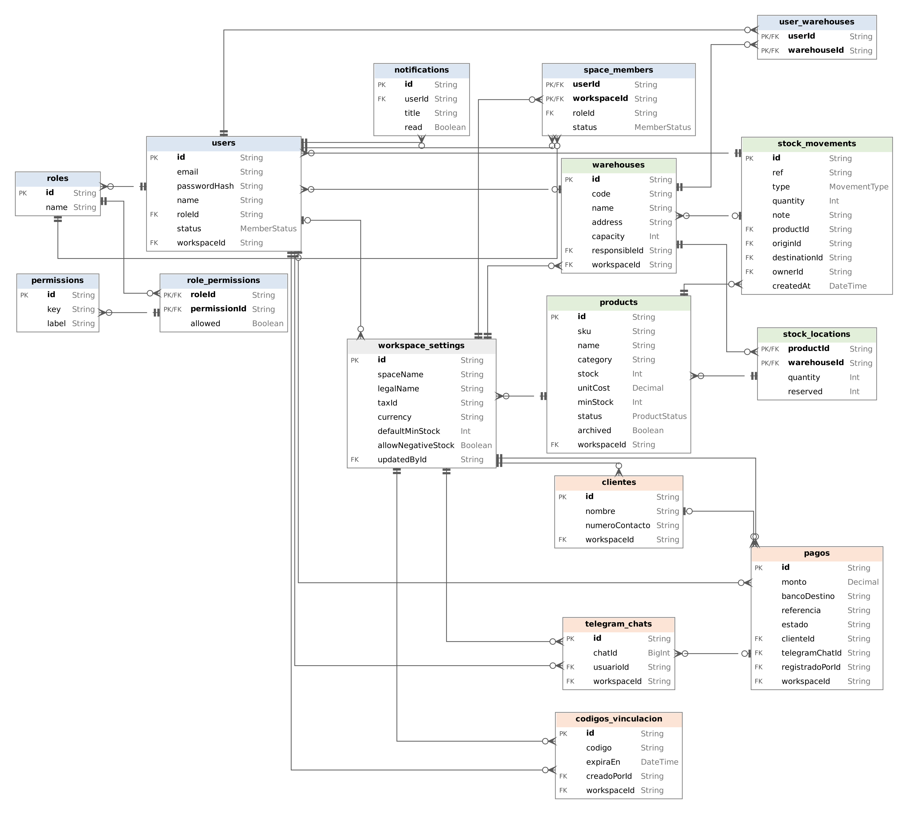

# Arquitectura

Chink es una aplicación web con arquitectura cliente/servidor. El usuario entra desde el navegador del computador o del celular, la interfaz le pide los datos al servidor por medio de una API REST y el servidor es el único que habla con la base de datos.

## Capas del sistema

**Frontend (cliente).** Está hecho en React con TypeScript y Vite, con Tailwind para los estilos. Tiene una página por cada módulo: Inicio, Inventario, Movimientos, Almacenes, Pagos, Reportes, Equipo y Configuración, además del inicio de sesión, el registro y la activación de cuentas. El menú muestra solo las opciones que permite el rol del usuario y en el celular se convierte en una barra abajo de la pantalla.

**Backend (servidor).** Es una API hecha en Node.js con Fastify y TypeScript. Cada módulo tiene su propio archivo de rutas (inventario, movimientos, almacenes, equipo, reportes, configuración, notificaciones, pagos, clientes y Telegram). La autenticación se hace con tokens JWT y los permisos se revisan con un `preHandler` llamado `requirePermission`, que mira si el rol del usuario tiene el permiso que pide cada ruta (`consult`, `register`, `adjust`, `report` o `admin`).

**Base de datos.** Usamos PostgreSQL y nos conectamos a ella con Prisma. El esquema está en `packages/db/prisma/schema.prisma` y los cambios se aplican con migraciones. Para tener datos de prueba hay un seed que carga productos, almacenes, movimientos y usuarios de ejemplo.

**Servicios externos.** El sistema usa un bot de Telegram para recibir fotos de comprobantes de pago, un servicio de almacenamiento para las imágenes de los productos y correo para enviar reportes e invitaciones.

## Organización del código

El proyecto es un monorepo manejado con pnpm y Turborepo:

```
chink/
├── apps/
│   ├── api/        → servidor Fastify (rutas, plugins y librerías)
│   └── web/        → interfaz en React (páginas, componentes y llamadas a la API)
├── packages/
│   └── db/         → esquema de Prisma, migraciones y seed
├── nginx/          → configuración del servidor web en producción
└── docker-compose.yml
```

## Modelo de la base de datos

La base de datos tiene 16 tablas, que se pueden agrupar en cuatro partes:

* **Usuarios y permisos**: `users`, `roles`, `permissions`, `role_permissions`, `space_members`, `user_warehouses` y `notifications`.
* **Inventario**: `products`, `warehouses`, `stock_locations` (cuántas unidades hay de cada producto en cada almacén) y `stock_movements` (entradas, salidas, transferencias y ajustes).
* **Espacio de trabajo**: `workspace_settings`, que guarda los datos y las reglas de cada tienda.
* **Pagos**: `clientes`, `pagos`, `telegram_chats` y `codigos_vinculacion`.



Algunas relaciones importantes:

* Un rol tiene muchos usuarios y muchos permisos (tabla intermedia `role_permissions`).
* Un producto puede estar en varios almacenes, y la cantidad en cada uno se guarda en `stock_locations`.
* Cada movimiento de stock pertenece a un producto, al usuario que lo hizo y a uno o dos almacenes (origen y destino).
* Cada tienda tiene su propio espacio, así que el SKU de un producto solo tiene que ser único dentro de la misma tienda.
